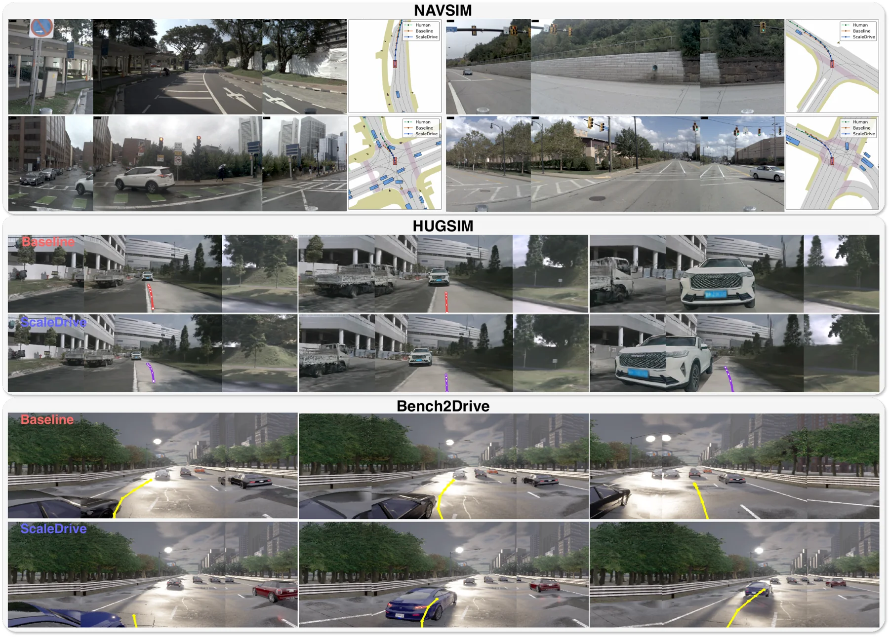

<h1>ScaleDrive</h1>
<h3>Scaling Action-Free Video Latent Prediction for Transferable Representations in End-to-End Autonomous Driving</h3>

Xingtai Gui1,\*†, Xubin Zhou2,\*, Yucheng Zhou1,\*, Dongqian Guo1, 
Jiahao Gong3, Feiyang Tan3, Jianbing Shen1,‡

1 SKL-IOTSC, Department of AI, University of Macau 
2 Harbin Institute of Technology 
3 Afari Intelligent Drive

(\*) Equal contribution. (†) Work done during the internship at Afari Intelligent Drive. (‡) Corresponding author.

<a href="https://um-lab.github.io/ScaleDrive/">Project Page</a>

## TODO

- [ ] Release ScaleDrive training code.
- [ ] Release ScaleDrive evaluation code.

## Abstract

End-to-end autonomous driving policies require effective visual representations that capture both spatial scene structure and temporal dynamics. Video latent prediction has emerged as an effective paradigm for learning spatiotemporal visual representations, yet it remains unclear whether scaling this objective with action-free driving videos can yield representations that benefit end-to-end planning. We study action-free video latent prediction as a scalable pretraining objective and introduce ScaleDrive, a driving-oriented framework pretrained exclusively on large-scale internet open-world driving videos, without action annotations or benchmark-specific data. We keep the pretrained video encoder frozen during downstream end-to-end planning training to isolate the transferability of representations learned from internet driving videos. Ego-motion and depth probes show that scaling action-free video pretraining progressively strengthens the temporal and geometric information encoded in the frozen representation. We systematically study the visual representation transfer across different end-to-end driving policies and closed-loop benchmarks, where ScaleDrive consistently improves downstream performance and demonstrates that scaling action-free video latent prediction yields representations that generalize across both planning policy architectures and evaluation scenarios and protocols.

## Qualitative Results

The figure shows qualitative comparisons on NAVSIM, HUGSIM, and Bench2Drive.

